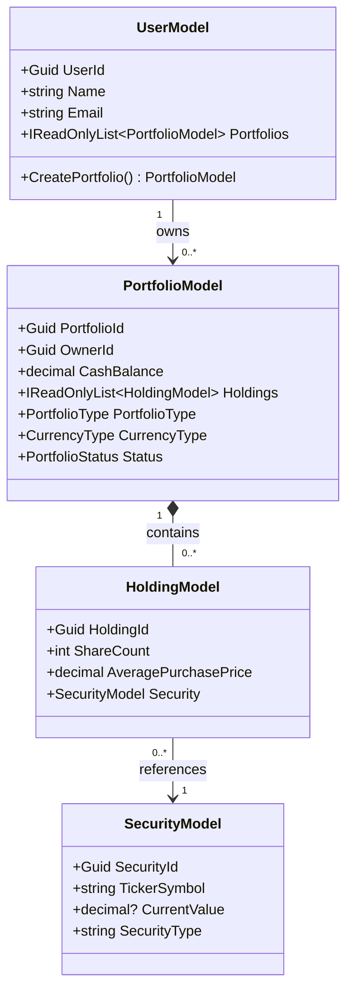

# Sep2026

## Project structure

The solution targets .NET 10 and contains four application projects and a Domain test project:

| Project | Responsibility | Project references |
| --- | --- | --- |
| `Sep2026.Domain` | Portfolio, holding, security and user models, business rules, and `MarketQuote` | None |
| `Sep2026.Application` | Use cases in `Services`, shared contracts in `Interfaces`, and application DTOs in `DTOs` | Domain |
| `Sep2026.Infrastructure` | Market API implementations in `MarketData`; SQL Server context, generated entities, and schema scripts in `Persistence` | Application, Domain |
| `ConsoleApp` | Executable entry point, configuration, and dependency injection setup | Application, Infrastructure |
| `Sep2026.Domain.Tests` | Restoration, validation, quote-state, and holding-calculation regression tests | Domain |

```text
Sep2026.slnx
ConsoleApp/
    Program.cs
    appsettings.json
    Configuration/AlpacaOptions.cs
Sep2026.Domain/
    UserModel.cs
    PortfolioModel.cs
    HoldingModel.cs
    SecurityModel.cs
    MarketQuote.cs
    RESTORATION.md
Sep2026.Domain.Tests/
    RestorationTests.cs
Sep2026.Application/
    DTOs/AssetDto.cs
    Interfaces/IMarketDataProvider.cs
    Services/TradeService.cs
Sep2026.Infrastructure/
    MarketData/MarketDataClient.cs
    MarketData/AssetApiResponse.cs
    MarketData/QuoteApiResponse.cs
    Persistence/GeminoDbContext.cs
    Persistence/Entities/
    Persistence/Sql/001_CreatePortfolioDatabase.sql
```

`IMarketDataProvider` belongs to Application. Infrastructure implements it with
`MarketDataClient` and maps Alpaca response objects to `AssetDto` and `MarketQuote`.
Provider JSON attributes stay in Infrastructure. The latest-trade response model
follows [Alpaca's latest trade endpoint](https://docs.alpaca.markets/us/reference/stocklatesttradesingle-1).

Keep dependencies pointing toward Domain: Domain must not reference Application
or Infrastructure, and Application must not reference Infrastructure. The console
project constructs and connects implementations at startup.

`TradeService` is currently an empty placeholder. The EF Core packages, generated
entities, and `GeminoDbContext` are in Infrastructure. Repositories and broker
workflows have not been implemented. The
initial SQL Server schema is versioned under `Persistence/Sql`. See the
[database setup instructions](Sep2026.Infrastructure/Persistence/Sql/README.md)
for creating the `Gemino` portfolio tables and market-price history. Broker order submission and execution
history are deferred until an external broker integration is introduced.

Build and run from the solution directory:

```powershell
dotnet build Sep2026.slnx
dotnet run --project ConsoleApp/ConsoleApp.csproj
```

In Visual Studio, open `Sep2026.slnx` and select `ConsoleApp` as the startup project.
The console entry point validates configuration, creates a scope, resolves the
database context and market data provider, prints a startup message, and exits.
It does not query SQL Server or call Alpaca during startup.

## Console startup and configuration

`ConsoleApp/Program.cs` is the composition root: it loads settings, registers
dependencies, builds and starts the host, runs an application workflow, and stops
the host. Business logic belongs in Application services and Domain models.

The [.NET Generic Host](https://learn.microsoft.com/en-us/dotnet/core/extensions/generic-host)
loads configuration in this order, with later sources overriding earlier ones:

1. `appsettings.json`.
2. `appsettings.{Environment}.json`, if present.
3. User secrets when the environment is `Development`.
4. Environment variables.
5. Command-line configuration arguments.

The content root is the executable directory, and settings files are copied there
on build and publish. This keeps settings loading consistent when launching from
Visual Studio, the solution directory, or a published folder.

`AlpacaOptions` binds the `Alpaca` section. `ApiKeyId`, `ApiSecretKey`, and `Feed`
must not be blank; missing values cause startup validation to fail. The committed
settings file contains the local SQL Server connection string, default `iex` feed,
and logging settings. It contains no API credentials or database password.

Set your local credentials using user secrets (replace the example values):

```powershell
dotnet user-secrets set "Alpaca:ApiKeyId" "YOUR_API_KEY" --project ConsoleApp/ConsoleApp.csproj
dotnet user-secrets set "Alpaca:ApiSecretKey" "YOUR_SECRET_KEY" --project ConsoleApp/ConsoleApp.csproj
dotnet run --project ConsoleApp/ConsoleApp.csproj
```

The `ConsoleApp` launch profile sets `DOTNET_ENVIRONMENT=Development`, so
Visual Studio and `dotnet run` load user secrets. User secrets are stored outside
the repository. Keep actual credentials out of committed JSON and launch settings.

For a published app or container, provide environment variables instead:

```powershell
$env:Alpaca__ApiKeyId = "YOUR_API_KEY"
$env:Alpaca__ApiSecretKey = "YOUR_SECRET_KEY"
dotnet run --project ConsoleApp/ConsoleApp.csproj --no-launch-profile
```

Double underscores represent configuration section separators in environment
variables. For example, `Alpaca__Feed` overrides `Alpaca:Feed`. A command-line
override can also be passed with `--Alpaca:Feed=iex` after `dotnet run ... --`.

`AddHttpClient<IMarketDataProvider, MarketDataClient>` registers the provider as a
typed HTTP client. Dependencies should request `IMarketDataProvider`, while the
console startup selects the Infrastructure implementation. See Microsoft's
[HTTP client factory guidance](https://learn.microsoft.com/en-us/dotnet/core/extensions/http-client).

## Database context registration

`Program.cs` reads `ConnectionStrings:Gemino` and registers the generated context:

```csharp
var connectionString = builder.Configuration.GetConnectionString("Gemino");
if (string.IsNullOrWhiteSpace(connectionString))
    throw new InvalidOperationException("Set ConnectionStrings:Gemino in configuration.");

builder.Services.AddDbContext<GeminoDbContext>(options =>
    options.UseSqlServer(connectionString));
```

The default in `ConsoleApp/appsettings.json` uses `.\SQLEXPRESS`, database `Gemino`,
and Windows authentication. Replace the server with the instance used when you
created/scaffolded the database. The local-development example trusts the server
certificate. A user-secret override can supply your own connection string:

```powershell
dotnet user-secrets set "ConnectionStrings:Gemino" "Server=.\SQLEXPRESS;Database=Gemino;Integrated Security=True;Encrypt=True;TrustServerCertificate=True;" --project ConsoleApp/ConsoleApp.csproj
```

The environment-variable equivalent is `ConnectionStrings__Gemino`.

`AddDbContext` registers a scoped service. Console apps create their own scope:

```csharp
await using var scope = host.Services.CreateAsyncScope();
var dbContext = scope.ServiceProvider.GetRequiredService<GeminoDbContext>();
```

Future repositories resolved from that scope will share the same context. Create
a fresh scope for each independent operation. Resolving a context configures it;
the connection is opened when a database operation is requested. Startup currently
performs no database queries or schema changes. See Microsoft's
[DbContext lifetime and configuration guidance](https://learn.microsoft.com/en-us/ef/core/dbcontext-configuration/).

## Domain model

The Domain restoration factories preserve saved identities and state through
validated private constructors. See the [restoration guide](Sep2026.Domain/RESTORATION.md)
for validation rules, examples, and tests that run without SQL Server.


