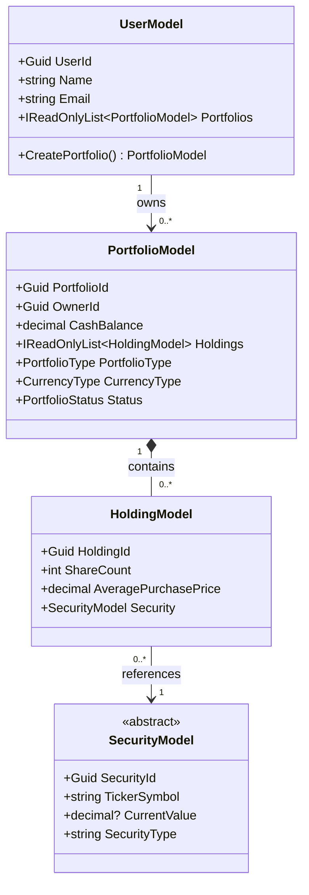

# Sep2026

## Project structure

The solution targets .NET 10 and contains four projects:

| Project | Responsibility | Project references |
| --- | --- | --- |
| `Sep2026.Domain` | Portfolio, holding, security and user models, business rules, and `MarketQuote` | None |
| `Sep2026.Application` | Use cases in `Services`, shared contracts in `Interfaces`, and application DTOs in `DTOs` | Domain |
| `Sep2026.Infrastructure` | External service implementations and provider-specific response models in `MarketData`; future database access in `Persistence` | Application, Domain |
| `ConsoleApp` | Executable entry point, configuration, and dependency injection setup | Application, Infrastructure |

```text
Sep2026.slnx
ConsoleApp/
    Program.cs
    appsettings.json
    Configuration/AlpacaOptions.cs
Sep2026.Domain/
    UserModel.cs
    PortfolioModel.cs
    HoldingModel.cs
    SecurityModel.cs
    MarketQuote.cs
Sep2026.Application/
    DTOs/AssetDto.cs
    Interfaces/IMarketDataProvider.cs
    Services/TradeService.cs
Sep2026.Infrastructure/
    MarketData/MarketDataClient.cs
    MarketData/AssetApiResponse.cs
    MarketData/QuoteApiResponse.cs
    Persistence/Sql/001_CreatePortfolioDatabase.sql
```

`IMarketDataProvider` belongs to Application. Infrastructure implements it with
`MarketDataClient` and maps Alpaca response objects to `AssetDto` and `MarketQuote`.
Provider JSON attributes stay in Infrastructure. The latest-trade response model
follows [Alpaca's latest trade endpoint](https://docs.alpaca.markets/us/reference/stocklatesttradesingle-1).

Keep dependencies pointing toward Domain: Domain must not reference Application
or Infrastructure, and Application must not reference Infrastructure. The console
project constructs and connects implementations at startup.

`TradeService` is currently an empty placeholder. Database packages, repositories,
migrations, and trading workflows have not been added yet. The
initial SQL Server schema is versioned under `Persistence/Sql`. See the
[database setup instructions](Sep2026.Infrastructure/Persistence/Sql/README.md)
for creating the `Gemino` portfolio tables and market-price history, and preparing
for EF Core database-first scaffolding. Broker order submission and execution
history are deferred until an external broker integration is introduced.

Build and run from the solution directory:

```powershell
dotnet build Sep2026.slnx
dotnet run --project ConsoleApp/ConsoleApp.csproj
```

In Visual Studio, open `Sep2026.slnx` and select `ConsoleApp` as the startup project.
The console entry point validates configuration, constructs the market data
provider, prints a startup message, and exits. It does not call Alpaca during
startup.

## Console startup and configuration

`ConsoleApp/Program.cs` is the composition root: it loads settings, registers
dependencies, builds and starts the host, runs an application workflow, and stops
the host. Business logic belongs in Application services and Domain models.

The [.NET Generic Host](https://learn.microsoft.com/en-us/dotnet/core/extensions/generic-host)
loads configuration in this order, with later sources overriding earlier ones:

1. `appsettings.json`.
2. `appsettings.{Environment}.json`, if present.
3. User secrets when the environment is `Development`.
4. Environment variables.
5. Command-line configuration arguments.

The content root is the executable directory, and settings files are copied there
on build and publish. This keeps settings loading consistent when launching from
Visual Studio, the solution directory, or a published folder.

`AlpacaOptions` binds the `Alpaca` section. `ApiKeyId`, `ApiSecretKey`, and `Feed`
must not be blank; missing values cause startup validation to fail. The committed
settings file contains only the default `iex` feed and logging settings.

Set your local credentials using user secrets (replace the example values):

```powershell
dotnet user-secrets set "Alpaca:ApiKeyId" "YOUR_API_KEY" --project ConsoleApp/ConsoleApp.csproj
dotnet user-secrets set "Alpaca:ApiSecretKey" "YOUR_SECRET_KEY" --project ConsoleApp/ConsoleApp.csproj
dotnet run --project ConsoleApp/ConsoleApp.csproj
```

The `ConsoleApp` launch profile sets `DOTNET_ENVIRONMENT=Development`, so
Visual Studio and `dotnet run` load user secrets. User secrets are stored outside
the repository. Keep actual credentials out of committed JSON and launch settings.

For a published app or container, provide environment variables instead:

```powershell
$env:Alpaca__ApiKeyId = "YOUR_API_KEY"
$env:Alpaca__ApiSecretKey = "YOUR_SECRET_KEY"
dotnet run --project ConsoleApp/ConsoleApp.csproj --no-launch-profile
```

Double underscores represent configuration section separators in environment
variables. For example, `Alpaca__Feed` overrides `Alpaca:Feed`. A command-line
override can also be passed with `--Alpaca:Feed=iex` after `dotnet run ... --`.

`AddHttpClient<IMarketDataProvider, MarketDataClient>` registers the provider as a
typed HTTP client. Dependencies should request `IMarketDataProvider`, while the
console startup selects the Infrastructure implementation. See Microsoft's
[HTTP client factory guidance](https://learn.microsoft.com/en-us/dotnet/core/extensions/http-client).

## Domain model


