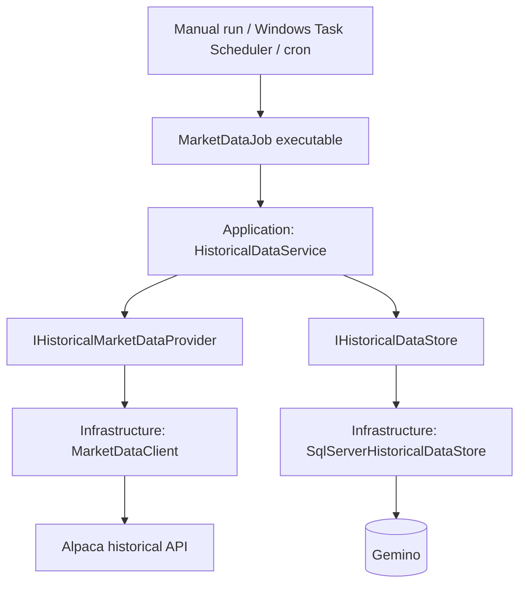

# Historical market-data ETL pipeline

Status: proposed implementation plan. Written 20 November 2026.

This document describes future work. It does not install a scheduler, change the
database, enable collection, or add application code. Proposed defaults below are
planning assumptions; the data frequency and execution location are still open.

## Purpose and terminology

Collect historical market data from Alpaca into Gemino so that future charts,
security analysis, and portfolio valuation can read a consistent local dataset.
Collection should support an initial historical download and repeatable catch-up
runs after missed schedules or failures.

This is **batch ETL: Extract, Transform, Load**:

1. Extract historical bars from the external API.
2. Transform provider responses into validated, normalized application records.
3. Load those records and collection progress into SQL Server.

Reverse ETL would move prepared analytical data from a warehouse/database into an
operational destination, such as a CRM. That is a different direction from this
feature. If a future design first stores raw API payloads and transforms them
inside the database, that part would instead follow ELT. These distinctions follow
[IBM's ETL overview](https://www.ibm.com/think/topics/etl).

The scheduler decides **when** collection starts. The ETL service decides **what
to collect and how to recover**. Scheduling alone does not provide reliable ETL.

## Relationship to connected portfolio management

The [updated project scope](CONNECTED_PORTFOLIO_SCOPE.md) defines portfolio creation
as connecting an external investment account. The provider supplies account cash,
positions, and account metadata; a dedicated private account-sync workflow imports
that state into the local portfolio.

This ETL feature collects historical market bars independently. It shares verified
security identities where appropriate, while leaving portfolio balances and
holdings to account synchronization. Provider account authorization and configured
market-data access are separate capabilities, even when supplied by the same
provider. Existing application-wide market API credentials must not be treated as
authorization for every owner's account.

For the first ETL version, retain a small configured symbol list. Later it may be
expanded from synchronized holdings or user watchlists with explicit rules for
instrument mapping, feed entitlement, deduplication, and retention. Collect shared
history once per compatible series rather than once per linked account. Historical
prices and current positions alone do not establish actual portfolio returns;
those need appropriate account history and cash-flow information.

[Link Portfolio](LINK_PORTFOLIO_IMPLEMENTATION_PLAN.md) and manual account sync
are now the next portfolio features. This document remains the separate
implementation plan for scheduled historical collection.

## Current project and proposed scope

The existing implementation has:

- `IMarketDataProvider` and `MarketDataClient` for asset metadata and latest-trade
  prices, but no historical bar operation.
- One SQL Server database, `Gemino`, and the database-first `GeminoDbContext`.
- `Securities` for local security references and optional latest-price caches.
- `MarketPriceSnapshots` for single observed prices with provider timestamps.
- An interactive console host that stops when the user exits.

An OHLCV bar represents open, high, low, close, and volume over a period. A
single-price snapshot cannot represent all of those fields. Add historical-bar
storage rather than changing the meaning of `MarketPriceSnapshots`.

Recommended first release:

| Decision | Proposed default | Reason / constraint |
| --- | --- | --- |
| Source | Alpaca US stock historical bars | Reuse the existing provider integration |
| Frequency | `1Day` OHLCV bars | Keep storage, requests, and validation manageable |
| Symbols | Small explicit configuration list | Independent of whether portfolios already contain holdings |
| Initial history | Explicit start date; approximately one year initially | Make the scope and expected request volume visible |
| Updates | Once daily, with catch-up | Device downtime must not cause permanent gaps |
| Feed | Explicit `iex`, subject to the account's permissions | Match current configuration; never silently substitute another feed |
| Currency | Explicit USD | Keep the first dataset consistent |
| Adjustment | Explicit `raw` for version one | Preserve source price history without silently mixing adjustment bases |
| Execution | Separate command that runs once and exits | Can be launched manually or by an external scheduler |
| Destination | New tables in the existing Gemino database | No additional database is needed |

IEX covers one exchange; SIP represents consolidated US exchange data. Their
results must remain distinguishable. Historical access also depends on the
account's permissions. See [Alpaca's market-data FAQ](https://docs.alpaca.markets/us/docs/market-data-faq).

Raw prices can jump at splits and do not represent dividend-inclusive returns.
Analytics must identify this dataset as raw. An adjusted series can be added
separately later, with a policy to refresh its older history after corporate
actions. A short overlap window alone cannot repair all adjusted history.

The first release excludes order submission, account execution history,
continuous streaming, minute bars, full-market downloads, automatic symbol-rename
reconciliation, and calculation of portfolio investment returns.

## Dependency and execution flow

Compile-time dependencies remain: Application references Domain; Infrastructure
references Application and Domain; executable hosts reference Application and
Infrastructure. Application must not reference EF Core, SQL clients, HTTP response
models, or the scheduler.

Historical bars are data records, not portfolio aggregates. Do not restore a
`PortfolioModel`, replay buy/sell operations, or load holdings to collect them.

## Proposed modules and file changes

Names are proposed, not existing APIs. Group related small record types instead
of creating one project or abstraction for every class.

| Location | Addition / change | Responsibility |
| --- | --- | --- |
| Application `Services/HistoricalDataService.cs` | New scoped service | Plan windows, call the provider, validate bars, and coordinate saving |
| Application `Interfaces/IHistoricalMarketDataProvider.cs` | New focused contract | Request historical pages and obtain eligible completed-session boundaries |
| Application `DTOs/HistoricalDataDtos.cs` | New grouped records | Series definition, request, page, bar, and run result; no provider JSON attributes |
| Application `Interfaces/IHistoricalDataStore.cs` | New persistence contract | Resolve local security references, read series progress, save a completed window, record run outcomes |
| Infrastructure `MarketData/MarketDataClient.cs` | Extend existing client to implement the historical contract | Historical HTTP requests and any required calendar lookup; reuse credentials and HTTP configuration |
| Infrastructure `MarketData/HistoricalBarsApiResponse.cs` | Provider response records | Deserialize provider fields and map them into application records |
| Infrastructure `Persistence/Stores/SqlServerHistoricalDataStore.cs` | New implementation | Transactional upserts, checkpoints, security registration, and job-run records |
| Infrastructure `Persistence/Sql/003_AddHistoricalMarketData.sql` | Proposed next schema script | Add tables, constraints, and indexes; confirm the next unused script number at implementation time |
| Infrastructure context and generated entities | Re-scaffold after schema changes | Follow the existing database-first workflow |
| New `Sep2026.MarketDataJob` executable | Separate host | Bind configuration, acquire the run lock, create a scope, execute once, report an exit code |
| Host configuration registration | Extract shared registrations when needed | Reuse persistence and market-data registration without depending on the interactive console |
| Existing test projects and a job-host test project if needed | Add focused tests | Cover transformation, orchestration, SQL behavior, and command lifecycle |

Keep the existing latest-price contract available. Historical pagination and
session selection belong to the new focused contract. Reusing the same
Infrastructure client avoids duplicating credentials and request setup.

The store is similar to a repository in that it hides persistence. Its contract
is about importing a dataset and committing progress, so a dedicated data store
is clearer than adding historical operations to `IPortfolioRepository`.

No generic repository, separate holdings repository, new unit-of-work interface,
message broker, or orchestration platform is required for this release. EF Core
is sufficient for small daily batches. Reconsider bulk loading only after
measurement shows a need.

## Proposed database model

Use three new tables in `Gemino`. Exact SQL types and constraints are finalized
in the schema step, before scaffolding.

### HistoricalDataSeries

One row defines the dataset for a security and stores its checkpoint:

- `SeriesId`: generated identity / primary key.
- `SecurityId`: foreign key to `Securities`.
- `Provider`, `Feed`, `CurrencyType`, `Timeframe`, `Adjustment`: explicit identity
  of the series; unique together with `SecurityId`.
- `RequestSymbol` and pinned symbol-mapping/as-of metadata: record the provider
  identity used for this series. Do not silently overwrite identity mappings.
- `HistoryStartSession`: earliest configured session covered by this series.
- `CoveredThroughSession`: latest session date for which every requested window
  from that start completed successfully; nullable before the first commit.
- `LastSuccessfulAt`, `RowVersion`: progress metadata and concurrency protection.

The checkpoint describes successfully processed request coverage, not simply
the maximum timestamp found in the bars table. A window may legitimately return
no bars, and a failed page must not advance coverage.

Resolve configured symbols against provider asset metadata before collecting.
Reuse matching local security records; create missing verified references with
their type and currency, without adding holdings or synthetic current prices.
Fetch asset metadata once when required, rather than for every history page.
The current unique ticker constraint is suitable only for this limited US-stock
scope. Stop and report ambiguous or changed symbol mappings; broader asset
classes and automatic rename handling need an explicit provider-identity model.

### HistoricalBars

- `BarId`: generated identity / primary key.
- `SeriesId`: foreign key to `HistoricalDataSeries`.
- `BarTimestamp`: provider bar timestamp stored in UTC as `datetimeoffset(7)`.
- `SessionDate`: exchange-local trading date, derived using the market timezone.
- `Open`, `High`, `Low`, `Close`: decimal prices with an explicit precision policy.
- `Volume`: nonnegative numeric value with provider-compatible range/precision.
- Optional `TradeCount` and `Vwap`, if returned.
- `ReceivedAt` and `UpdatedAt`: local collection timestamps in UTC.

Add a unique constraint on `(SeriesId, BarTimestamp)` and a range-query index
appropriate for `(SeriesId, SessionDate)`. Keep supported timeframes restricted
to daily bars for version one, even though the series identity reserves the field.

Identical re-imports must not add rows or unnecessarily rewrite receipt metadata.
If the provider revises a bar, update that row and its update timestamp. Keep
earliest receipt time distinct from the time of a correction. Version one stores
the latest received revision, not a full revision audit trail.

### MarketDataJobRuns

Store `RunId`, mode, start/end times, status, requested scope/settings, inserted,
updated and unchanged counts, failure summary, and an application version when
available. Statuses should distinguish running, succeeded, partially failed,
failed, cancelled, and skipped because another run owns the lock.

Use structured logs for per-window detail instead of introducing a separate
table for every request. An interrupted process may leave a running record; mark
such records interrupted on the next lock-owning run. Run history is diagnostic;
series checkpoints remain the source of truth for recovery.

Historical collection does not overwrite `Securities.CurrentValue`, `QuoteAt`,
cash balances, or holdings. Historical closes and current valuation quotes have
different meanings.

## Extract, transform, and load algorithm

### Extract

Use Alpaca's historical stock-bars endpoint with explicit request settings.
Follow `next_page_token` until exhaustion; never infer completion from the number
of bars returned. The endpoint accepts date ranges, timeframe, feed, currency,
and adjustment options. See the [historical bars reference](https://docs.alpaca.markets/us/reference/stockbars).

Start with one symbol at a time and bounded windows of at most one calendar
month. This bounds memory and makes retries easy to understand. Detect repeated
page tokens and impose a request/deadline limit so malformed pagination cannot
loop forever.

Before requesting daily bars, select only trading dates whose full provider
daily period and availability delay have passed. Conservatively wait until the
next New York midnight plus that delay; regular-session close alone does not
prove a daily bar covering extended hours is complete. Use a market calendar
and exchange timezone; do not treat UTC midnight, the user's timezone, or every
weekday as a market session. Early closes and holidays matter. Alpaca provides
session dates and
open/close times in its [US market calendar](https://docs.alpaca.markets/us/reference/legacycalendar).

### Transform

- Normalize symbols and currency identifiers without changing prices or volume.
- Validate the requested security/series identity and timestamp range.
- Preserve the provider's timestamp; derive session dates using New York market
  time, including daylight-saving transitions. Handle OS timezone identifiers.
- Require positive OHLC prices, `Low <= Open <= High` and `Low <= Close <= High`, nonnegative volume,
  and valid optional values. Reject missing fields rather than substituting zero.
- Use decimal arithmetic and explicitly handle SQL precision limits. Never
  silently round or truncate an out-of-range value into a valid-looking bar.
- Detect conflicting duplicate timestamps within the same download.
- Keep raw and adjusted data, currencies, and feeds in separate series.

A bad record fails its window. Record the reason and retain the previous
checkpoint. Do not silently discard it and report complete coverage. Do not
invent zero-price bars or forward-fill missing observations during ingestion.

### Load and commit

1. Finish fetching and validating all pages for one bounded window in memory.
2. Open a short SQL transaction.
3. Insert missing bars and update revised bars using the unique series/timestamp
   key. Apply database constraints as the final protection against duplicates.
4. Advance `CoveredThroughSession` only when this window extends contiguous
   successful coverage. An overlap/replay must not move it backwards or skip a gap.
5. Commit bars and checkpoint together. Clear tracked batch entities afterward.

No SQL transaction remains open during an HTTP request or retry delay. If saving
fails, roll back both the bars and progress for that window. If the process stops
after commit but before reporting success, the next attempt can repeat the same
window safely.

An exhausted, valid response with no bars can complete a request window, but does
not prove that a security traded or that the provider's history is complete.
Log empty windows; flag unexpected missing observations on eligible sessions for
review. A permission error or malformed response never counts as an empty success.

## Backfill, catch-up, and reconciliation

**Backfill** processes an explicit start through the last eligible completed
session. A new series has no checkpoint. Commit windows in chronological order.
If a window fails, stop advancing that series; continue independent symbols if
appropriate and return an overall partial-failure result.

**Incremental sync** resumes from saved coverage with an overlap of, for example,
five completed sessions. This refreshes recent corrections and catches up all
missing windows after device downtime. When the overlap start and checkpoint
range do not intersect, use the earlier missing boundary; never jump forward to
just the most recent few days.

**Replay** explicitly re-downloads an already covered range for reconciliation.
It uses the same validation and upsert path and cannot advance coverage past an
unprocessed gap. Extending history earlier than `HistoryStartSession` requires
processing the new prefix fully before changing that boundary.

Example: coverage ends on Monday and the device is off until Friday. Friday's
run fetches the overlap plus all eligible Tuesday-through-Thursday data; it does
not request only Thursday. Repeating Friday's run leaves one row per series/bar.

Recent overlap cannot detect every old correction. Support manual replay for
older ranges; a periodic wider reconciliation can be scheduled later. Do not
claim an immutable or fully audited historical dataset in the first release.

## Scheduling, ownership, and process lifetime

Create `Sep2026.MarketDataJob` as a small command-line host that runs once and
exits. The interactive console remains a separate entry point. The scheduler
can run collection without a portfolio owner signing in, because market data is
shared reference data rather than a user's private account operation.

For the current Windows device, prefer Task Scheduler initially. It can launch
an application at scheduled times; see [Microsoft's Task Scheduler documentation](https://learn.microsoft.com/en-us/windows/win32/taskschd/task-scheduler-start-page).
Configure a missed-run/startup trigger and an execution deadline. A future Linux
deployment can use cron with the same executable. A scheduler embedded inside
the interactive console would stop whenever that console exits.

Private account synchronization needs its own schedule, owner/connection-scoped
credentials, concurrency boundary, and failure state. The market-data job lock
here protects market-history imports; account jobs should not blindly reuse that
global lock as their per-account synchronization policy.

Proposed cadence: once daily around 06:00 UTC. A five-field cron expression would
be `0 6 * * *` on a scheduler configured for UTC. This is a proposal, not an
installed job or a command ready to run. Windows triggers and timezone settings
must be configured explicitly; cron syntax is not Task Scheduler syntax.

The computer, network, and SQL Server must be available. A powered-off device
cannot collect; the next run catches up. Truly continuous availability requires
an always-running host, even if the application has a local database.

Acquire a SQL Server application lock for the entire job, shared by scheduled
and manual entry points. Use a named exclusive, session-owned `sp_getapplock`
with zero wait and check its result. Keep that physical connection owned by the
job until explicit release in `finally`; do not return a locked session to a
connection pool. Stop the job if that connection is lost and never silently
reconnect and continue under an assumed lock. This requires no transaction held
across API calls. See [SQL Server application locks](https://learn.microsoft.com/en-us/sql/relational-databases/system-stored-procedures/sp-getapplock-transact-sql).

Create scoped services/context instances for bounded work. Do not hold a
`DbContext` in a singleton scheduler. All entry points must honor the same lock;
keep unique keys and checkpoint concurrency checks even with that protection.

## Configuration, errors, and visibility

Bind job-specific configuration separately from provider credentials:

| Setting | Meaning |
| --- | --- |
| `Symbols` | Explicit, nonempty tracked symbol list |
| `BackfillStartDate` | Earliest requested exchange session date |
| `Timeframe`, `Feed`, `Currency`, `Adjustment` | Explicit series settings |
| `OverlapSessions` | Recent eligible sessions to refresh; proposed value 5 |
| `AvailabilityDelay` | Additional delay after a completed daily period |
| `WindowSize` | At most one calendar month for the initial daily implementation |
| `RequestTimeout`, `MaxRetries`, `MaxRunDuration` | Bounded network and job execution |

Reject unsupported settings before writing data. Changing series settings must
select/create a separate series, not silently repurpose an existing checkpoint.
The start date is an explicit configuration choice, not a hard-coded rolling
date that moves forward and loses unfinished backfill work.

Use existing configuration mechanisms for credentials. The scheduled OS account
must have access to its configured secrets and SQL Server; development user
secrets and Windows-integrated SQL permissions do not automatically transfer to
another account. Use absolute executable/configuration paths. Never put API
secrets in cron arguments, committed JSON, run records, or application logs.

Handle failures by category:

- Network errors, timeouts, HTTP 429, and eligible server errors: bounded retries
  with exponential delay/jitter; honor applicable retry/rate-limit headers.
- HTTP 400, 401, or 403: fail with a clear request/configuration/access error;
  do not repeatedly retry unchanged credentials or silently change feed.
- Cancellation/deadline: stop requests, roll back an active transaction, release
  the lock, and preserve previously committed windows.
- SQL conflicts or validation failures: report the affected series/window and
  preserve its previous checkpoint.

Proposed process exit codes: 0 for successful completion/no work, 1 for failed or
partially failed collection, 2 for invalid configuration, 3 for overlap skipped,
and 4 for cancellation. Document these alongside the runnable command when it
exists so the scheduler can handle retryable outcomes deliberately.

Logs/results should include run ID, symbol, series settings, requested window,
pages fetched, inserted/updated/unchanged counts, duration, retry count, coverage,
and failure category. Distinguish no new work, no returned bars, and failed work.
Later the console can display last successful collection and stale-series status
through a query service without becoming the scheduler.

## Implementation stages and acceptance checks

| Stage | Work | Complete when |
| --- | --- | --- |
| 1. Finalize the dataset contract | Confirm daily bars, symbols, backfill start, feed/adjustment, availability delay, and execution host | A small request scope and expected result can be described precisely |
| 2. Schema and scaffolding | Add the versioned SQL script, constraints, indexes, and generated mappings | Existing application data survives; schema setup is repeatable |
| 3. Provider adapter | Add historical requests, calendar boundaries, pagination, and response mapping | Fake HTTP responses verify parameters, multiple pages, errors, and cancellation |
| 4. Store and orchestration | Implement bounded backfill/sync/replay, transactional upsert/checkpoint, and run reporting | A manually invoked run saves valid data and safely resumes after failure |
| 5. Job executable | Add shared DI registration, validated settings, lock, exit codes, and shutdown | It runs without interactive prompts or user login and releases resources |
| 6. Scheduled deployment | Publish, configure paths/credentials, install a disabled task for inspection, then enable the selected schedule | A scheduled run and a missed-run catch-up are demonstrated |
| 7. Read-side access | Add historical query DTOs and collection status as needed | Charts/analysis read explicit series and report missing/stale data |

Do not install or enable an OS task as part of writing this proposal. The
scheduled deployment step comes after the command and its configuration exist
and can be inspected.

Required automated scenarios for the implementation:

- All pages are fetched, including empty pages with a continuation token;
  repeated tokens terminate with a failure.
- Wrong symbols, missing fields, invalid OHLC, range errors, decimal limits,
  conflicting duplicates, and cancellation are rejected correctly.
- Holiday, early-close, DST, and incomplete daily-period boundaries are handled.
- Raw/adjusted settings, feeds, and currencies cannot share a series accidentally.
- Importing the same window twice creates no duplicates; corrected prices update
  only their own series; cached latest quotes and portfolio state remain intact.
- A failure after a later HTTP page leaves that window and checkpoint unchanged;
  a SQL failure rolls back both; a crash after commit is safe to replay.
- A long gap catches up every window; empty successful windows differ from access
  failures; a failed middle window never permits coverage to skip ahead.
- Two job processes cannot both own the run lock, and lock loss stops writes.
- Secrets never appear in logs/run results; no profile login is requested.

Use fake providers for service tests, fake HTTP for adapter tests, and isolated
temporary SQL Server databases for transaction, uniqueness, and locking tests,
following the project's existing integration-test pattern. Live Alpaca tests
should be explicit, use a tiny bounded request, and never be required for the
regular test suite.

## Decisions to settle before implementation

The default plan is daily raw USD bars for selected US stocks, with a separate
scheduled executable. Confirm the symbols, historical start date, required feed,
and whether execution must continue while the console is closed. If minute bars
or an always-running remote host are required, revise batching, storage sizing,
and deployment before implementation rather than scaling this daily design
implicitly.
