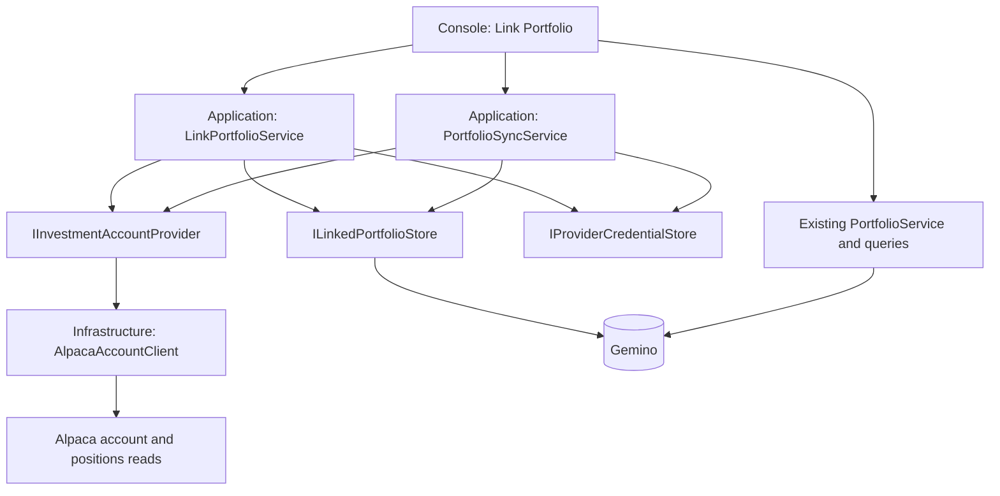

# Link Portfolio: implementation plan

Status: Application service/contracts implemented and tested, 20 November 2026.
The end-to-end feature still needs provider, credential, persistence, schema/Domain,
and presentation integration. The agreed feature name is **Link Portfolio**.

The [connected portfolio scope](CONNECTED_PORTFOLIO_SCOPE.md) defines the product
direction. This plan describes the first deliverable and its dependencies.

## Outcome and first release

The first implementation slice is `LinkPortfolioService` plus provider-neutral
snapshot/request/result records and dependency contracts in Application. Tests
use fake providers, persistence, credentials, and account locks. See the
[Application guide](../Sep2026.Application/README.md#link-portfolio-application-service)
for the implemented workflow, cancellation/uncertain-commit behavior, and limits.
No production linking request is enabled yet. Refresh remains planned work.

Implementation started with this Application slice before schema work, using
decimal quantities and nullable cost in the import contract. Existing Domain and
SQL types must be made compatible before wiring a real import implementation.

A signed-in Gemino owner selects Link Portfolio, supplies authorization for an
existing external investment account, and sees its imported cash and positions
in the portfolio list. Provider data is authoritative; Gemino maintains the local
view and its freshness. Existing local profile sign-in stays separate.

Recommended first-release boundary:

| Area | Proposal |
| --- | --- |
| Provider | Alpaca first, behind an Application contract |
| Environment | Paper account first; live enabled in a later explicit release |
| Access | Account/position reads only; no order or transfer operations |
| Authorization | User-supplied paper API credentials for the local console; OAuth is a separate authorization option to settle before coding |
| Account mapping | One authenticated paper account to one local portfolio; one connection record per linked account initially |
| Supported financial state | USD cash with a nonnegative balance, long US-equity positions including fractional quantities |
| Unknown cost | Preserve unavailable average cost as null; valid reported zero cost remains distinguishable from unknown |
| Updates | Initial import and manual Refresh from provider |
| Local preferences | Optional display name; provider/environment always visible |
| Deferred | Live accounts, other providers/instruments, shorts/negative cash, scheduled account refresh, order history, performance calculations |

These release limits are proposals, not restrictions assumed to apply to every
Alpaca account. Reject an unsupported snapshot as a whole with a clear reason.
Do not import the supported subset while presenting it as the complete account.

## Verified provider capabilities and authorization decision

Alpaca documents account reads at `GET /v2/account` and current open positions at
`GET /v2/positions`. A closed position is absent from the open-positions response.
Use the direct user's Trading API, not Broker API account-management endpoints.
See [Get Account](https://docs.alpaca.markets/us/reference/getaccount-1) and
[All Open Positions](https://docs.alpaca.markets/us/reference/getallopenpositions).

For the proposed local-console version, key/secret authentication is documented.
Paper and live accounts use different Trading API hosts and credentials. Bind
the host from a supported environment enum, never a user-entered arbitrary URL.
See [Alpaca authentication](https://docs.alpaca.markets/us/docs/authentication).

Alpaca also offers OAuth authorization with default read access and separate
write/trading scopes. An OAuth token can cover paper, live, or both, so environment
identity must remain explicit. See [Alpaca OAuth](https://docs.alpaca.markets/us/docs/using-oauth2-and-trading-api).

Recommendation for the current single-device console: start with paper keys to
keep the first integration small. This makes Gemino's implemented operations
read-only; it does not assert that the supplied key is itself read-only. If the
product requires provider-enforced read permissions or browser consent now,
choose OAuth before the authorization stage. Do not implement both flows in the
first slice or bundle a confidential OAuth application secret into a distributed
desktop executable. Verify the supported native-client/token-exchange design
before committing to that alternative.

Credential handling belongs to Infrastructure: protected device storage, an
opaque credential reference in SQL, hidden console input, and redacted diagnostic
representations. Local profile passwords are never provider credentials. Device
storage protects according to OS identity; it does not create independent OS
security boundaries between Gemino profiles using the same Windows account.

## User flow

1. Sign in and open the portfolio list, including its empty state.
2. Select `L: Link Portfolio`.
3. Select a supported provider/environment, enter an optional display name, and
   supply the required authorization through hidden secret input. Confirm the
   selected provider/environment before making the link request; cancellation
   before submission performs no import.
4. Show a loading screen while verifying the account and fetching its positions.
5. On success, clear the loading screen, display a safe account label and import
   summary, refresh the saved list, and allow the user to open the portfolio.
6. If already linked, show the existing portfolio; do not replace its credential
   or display name implicitly. Reauthorization is an explicit later operation.
7. On error, show a useful category and allow retry/back without exposing secrets.

The owner comes from the active Gemino session. Users do not type a Gemino User ID
or an external account UUID as proof of access. For the initial key-based adapter,
`GET /account` resolves the authenticated account; there is no invented list-all-
accounts screen. Other provider adapters may add verified account discovery later.

Use `S: Refresh from provider` in saved portfolio details. Existing `R: Reload
saved details` continues to mean a database read. Show last successful import,
local fetch time, provider observation time where available, and stale/error
state as separate facts.

## Service boundaries and dependency flow

Compile-time dependencies keep pointing inward. Interface implementations in
Infrastructure handle HTTP, protected credential access, SQL transactions, and
locking. Application handles owner access, workflow, validation, and outcomes.
Domain represents accepted state and its invariants, without console output.

| Component | Proposed responsibility |
| --- | --- |
| `LinkPortfolioService.LinkAsync` | Validate owner/input, verify credentials/account identity, detect duplicates, validate the initial snapshot, and commit the linked portfolio |
| `PortfolioSyncService.RefreshAsync` | Resolve an owner-authorized link, serialize refreshes, read the latest provider snapshot, and commit reconciliation |
| `IInvestmentAccountProvider` | Read account and complete positions using explicit environment/connection authorization; return provider-neutral records |
| `IProviderCredentialStore` | Save/read/delete protected credentials through opaque references; never return them in presentation DTOs |
| `ILinkedPortfolioStore` | Owner-scoped lookup, duplicate detection, atomic initial import/refresh, and concurrency checks |
| Existing `PortfolioService` / `IPortfolioQueries` | Read saved state, including new provider/display/freshness fields |

Keep related request/result/snapshot records together in an Application DTO file.
The link request needs provider, environment, and display name. Secret input is
a separate transient argument/type with a redacted representation, never part
of a printable request record or response DTO. The returned DTO contains local
portfolio identity, safe provider/account labels, outcome, and sync timestamps.

Provider JSON response records stay in Infrastructure. Normalize numeric strings
using invariant decimal parsing. Incoming provider records map to a validated
snapshot; persistence maps accepted values into EF entities. Saved-data reads
continue to use the existing entity-to-Domain-to-DTO path after compatible model
changes. Import must not replay `ApplyBuy`, `ApplySell`, or deposit/withdraw methods.

Use the store's transaction boundary directly; a generic repository or new
unit-of-work abstraction is unnecessary. Keep the existing read repository.
Do not add empty abstractions before their first implementing slice.

## Database-first changes

Reserve the next available numbered SQL script when implementation starts. The
historical ETL plan also proposes a future script, so confirm numbering then.
Apply a versioned additive migration to existing Gemino, update fresh-bootstrap
definitions as needed, then re-scaffold context/entities. Keep custom mapping and
validation outside generated files.

Proposed minimal additions:

| Object | Fields / constraints |
| --- | --- |
| `ProviderConnections` | Connection ID, Owner ID, Portfolio ID, provider, environment, opaque external account ID, credential reference, connection status, last attempt/success, sanitized failure, provider observation metadata, sync generation, row version |
| Connection uniqueness | Unique `(OwnerId, Provider, Environment, ExternalAccountId)` and one connection per local Portfolio ID for this release |
| Owner relationship | Enforce that a connection and its referenced portfolio have the same owner, including database relationship constraints |
| `ProviderSecurityMappings` | Provider/environment/external asset ID to local Security ID; unique provider instrument identity; ticker is a display/search attribute |
| `Portfolios` extensions | Optional display name; explicit imported type/unknown-type mapping and source metadata where appropriate |
| `Holdings` adjustments | Decimal quantities, nullable/nonnegative reported average cost, compatible constraints and precision |

Store the verified external account ID as an opaque string even if Alpaca
currently uses UUIDs. Normalize provider/environment identifiers and choose
comparison semantics for external identifiers explicitly.

Reuse `CreatedAt` for local portfolio creation; keep provider account creation,
fetch time, last successful sync, and provider valuation timestamps separate.
Connection status must not be stored in the existing Active/Archived enum.
Existing unlinked portfolios remain unlinked; never guess their provider or
assign newly supplied credentials to them automatically.

One connection per account keeps the first schema small. Supporting a future
authorization grant containing many accounts may extract a separate grant table;
do not force that cardinality into empty abstractions now.

## Domain and read-model compatibility

Fractional positions are an actual supported Alpaca capability; see
[fractional trading](https://docs.alpaca.markets/us/docs/fractional-trading).
Plan `decimal(28,9)` quantities, subject to final schema/response verification,
instead of `int`. Update `HoldingModel`, restoration factories, relevant arithmetic,
EF mappings, DTOs, and rendering together. Reject values exceeding the chosen
precision rather than rounding silently.

Make unknown average cost nullable through the same layers. An imported zero
cost and an unavailable cost are different values. Calculated cost/profit outputs
stay unknown when required inputs are missing. Review legacy mutation arithmetic
only for compatibility; this feature adds no trading workflow.

Keep the first adapter's nonnegative cash and long-position scope explicit.
Snapshot validation rejects shorts, negative cash, unsupported instruments,
currencies, or unresolvable security identity. Future broader support requires
changing those rules intentionally.

The provider account's cash field is distinct from buying power or equity.
Map it explicitly and preserve provider-reported metadata. Add an explicit
Unspecified/imported account-type representation if necessary rather than
defaulting an unknown provider account to Individual. Remove console output from
Domain paths being revised. Owner checks belong in Application reads as well as
writes, so a future API cannot bypass the current UI's ownership check.

## Initial import, transaction, and recovery rules

1. Validate the signed-in owner and supported provider/environment.
2. Keep new credentials transient while verifying account identity. Check for an
   existing owner/provider/environment/account link and return it if present.
3. Acquire a per-owner/provider/environment/account lock; recheck duplicates.
   Fetch/validate the full initial account and positions result while serialized.
4. Resolve stable security mappings and create a candidate snapshot with explicit
   fetch/provider times. Check both account reads belong to the same account.
5. Save the protected credential and obtain its reference. Start a short SQL
   transaction and insert portfolio, connection, security mappings, and holdings.
6. Commit the complete initial snapshot and sync metadata together. Only then
   return Linked and make the portfolio visible as imported.

Never keep a SQL transaction open during HTTP calls or user input. Database
uniqueness is authoritative even with early checks and locking. Handle a racing
duplicate by reading the existing authorized link, not returning a raw SQL error.

Protected storage and SQL are not one distributed transaction. If persistence
fails before a confirmed commit, clean up newly created unreferenced credentials.
If the commit outcome is uncertain, first reconcile using the unique account key;
do not delete a credential that may be referenced by a committed connection.
Define startup/maintenance cleanup of abandoned credentials with an ownership
marker and retention window; never enumerate/delete unrelated device secrets.

Failures before the first accepted import leave no visible zero-filled portfolio.
Verified empty positions and genuine zero cash are valid. Cancellation after a
confirmed commit must not report that nothing was saved.

## Manual refresh and consistency

Resolve owner access before touching credential storage. Use the same account
lock for link/relink/refresh paths, and compare row versions/generation before
commit. Disconnect or reauthorization must invalidate an in-flight refresh before
it can publish state. A lost lock stops the import.

Fetch the entire account/positions result outside the write transaction. Account
and positions endpoints do not establish an atomic external snapshot just
because their local writes are atomic. Use a bounded fetch-duration policy and
account identity/currency checks; retry known inconsistencies and record the
observation interval. Never label local import time as an atomic provider time.

In a short transaction, update cash, upsert holdings by stable instrument identity,
remove positions absent from a complete accepted positions result, update the
portfolio row version and sync generation, and mark success. Preserve holding IDs
for unchanged instruments. Closed-position removal updates current state, not an
execution archive. Preserve the last good snapshot after any failed refresh and
show a sanitized error/stale indicator.

Provider data and historical-market-data ETL remain separate jobs. No cron task
is needed for this first manual release.

## File-level implementation stages

| Stage | Files / areas | Acceptance result |
| --- | --- | --- |
| 1. Contract and mapping specification | Application provider/snapshot definitions; Domain invariant specification | One realistic paper-account fixture, including fractional/unknown-cost examples, maps unambiguously; settle API keys versus OAuth |
| 2. Compatible schema and models | Versioned SQL script, context/entities, Domain models, mappers, DTOs, render formatting | Existing data survives migration; new precision/null rules work through the saved read path |
| 3. Private provider adapter | Infrastructure `AccountProviders/AlpacaAccountClient.cs`, provider response records, isolated HTTP registration | Fake HTTP verifies correct account/environment/auth, complete positions, invariant parsing, errors, timeouts, and cancellation |
| 4. Credential and import persistence | Infrastructure credential implementation and `Persistence/Stores/LinkedPortfolioStore.cs` | Protected references, unique identity/owner constraints, rollback, and lock/generation behavior verified against isolated SQL |
| 5. Link orchestration | Application `Services/LinkPortfolioService.cs` plus grouped DTOs/contracts | Success, duplicate, unsupported snapshot, credential cleanup, and uncertain-commit recovery behave correctly |
| 6. Console Link Portfolio | `ConsoleInput`, `PortfolioConsoleApp`, `PortfolioRenderer`, DI configuration | `L` works on empty/nonempty lists, hides secrets, honors cancel, refreshes the list, and shows provider/source/freshness |
| 7. Manual refresh | Application `PortfolioSyncService`, store reconciliation, `S` detail action | Complete refresh is atomic/idempotent; errors retain the last good state; database reload remains separate |
| 8. Operational follow-up | Reauthorization/disconnect UX, retention policy, later scheduled refresh | Explicit lifecycle actions reuse the same account identity and invalidate stale work safely |

Infrastructure provider registration must not mutate the current global
`MarketDataClient` headers between users. Use connection-specific request
authorization with allowlisted hosts. Reuse shared HTTP plumbing only where
authorization and provider capability boundaries remain explicit.

## Verification and definition of done

Use the existing Domain, Application, Infrastructure, and Console test projects.
Application tests use fake providers/stores/credentials. Adapter tests use fake
HTTP; persistence tests use temporary SQL databases. Regular tests need no real
account credentials. A tiny opt-in live integration check uses a paper account
and performs only the documented reads.

Required scenarios:

- Successful account with fractional positions; true empty account; unknown and
  zero cost rendered distinctly; supported zero cash imported faithfully.
- Incorrect credentials/environment, provider failure, malformed or incomplete
  data, unsupported short/negative-cash/currency/instrument cases, and cancellation.
- Same account linked twice, concurrently, and after an uncertain response: one
  local portfolio; no credential replacement or duplicate secret leaks.
- Wrong-owner link/read/refresh; paper/live separation; secret-free logs, DTOs,
  run outcomes, exception messages, and record string representations.
- SQL rollback preserves the prior snapshot; an old or disconnected refresh
  cannot overwrite newer state; repeated sync preserves stable holding IDs.
- Migration preserves existing unlinked data; updated restoration and calculations
  handle decimal quantities and nullable cost without replaying business actions.
- UI scopes are disposed before the next prompt; no credentials or contexts are
  retained accidentally; screen clearing/loading remains functional.

Link Portfolio is complete for the first release when a local owner can link a
supported paper account, immediately browse its accepted imported state, repeat
the action safely, and manually refresh it with visible freshness and reliable
failure handling. Reauthorization, disconnect, live access, and schedules are
separate follow-up acceptance milestones, not silent additions to that claim.
